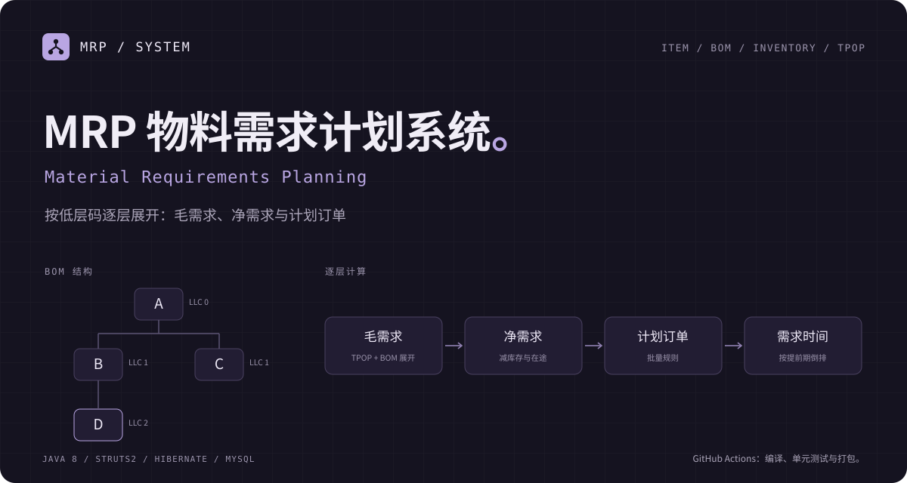

# Material Requirements Planning (MRP) System

[简体中文](README.md) · **English** · [Español](README.es.md) · [日本語](README.ja.md)

A Java 8, Struts2, and Hibernate application for exploring multi-level bills of materials (BOMs), inventory, and material requirements. Enter planned order releases for top-level items; the system calculates gross requirements, inventory projections, and planned orders over 13 period slots. JSP and Bootstrap provide the interface, MySQL stores inputs and results, and the calculation core can be tested without a database.

[Worked examples and deployment verification](docs/optimization-validation.md) · [Windows and Linux CI](.github/workflows/ci.yml)

## Set up and run

Use JDK 8, Maven 3.9, Tomcat 9, and MySQL. Create and select a dedicated sample schema such as `mrp_demo`. Import [mrp.sql](mrp.sql) or its identical [V1 baseline](db/migration/V1__legacy_schema.sql), then apply [V3](db/migration/V3__atomic_batches_and_past_due.sql) once. The baseline contains `DROP TABLE` and sample data, and neither creates nor selects a schema. Keep it away from existing business databases. V3 adds the recalculation lock row and out-of-horizon tables. [V2](db/migration/V2__period_line_tables.sql) is unused, and migrations are not run automatically.

From the repository root in PowerShell, replace the sample database credentials and run the build:

```powershell
$env:MRP_DB_URL = 'jdbc:mysql://localhost:3306/mrp_demo?useUnicode=true&characterEncoding=UTF-8'
$env:MRP_DB_USERNAME = 'mrp_user'
$env:MRP_DB_PASSWORD = '<database-password>'
powershell -NoProfile -File scripts\verify.ps1
```

The script runs `mvn -B clean verify` and inspects the WAR for application classes, configuration, and runtime dependencies. Deploy `target/mrp-1.0.0-SNAPSHOT.war` as `mrp.war` in Tomcat. Start Tomcat so it inherits the three database variables, or use the matching JVM properties in [the configuration example](src/hibernate.properties.example). Missing required configuration fails explicitly.

Open `/mrp/index.jsp`. Use the item, BOM, inventory, and top-level input screens to review or enter data. The MRP screen can recalculate the batch through `/mrp/MRP_domrp.action`; use it only on the dedicated sample schema for this walkthrough.

## Planning model

| Stage | What it does |
| --- | --- |
| Inputs | Maintain [items, BOM edges, and inventory](src/entity/). [TPOP](src/action/TPOPAction.java) accepts top-level planned releases in `POR0`–`POR12`; it does not generate a master production schedule from orders. |
| BOM explosion | [Validate the graph](src/service/BomGraph.java) and [accumulate requirements](src/service/MrpCalculationService.java) in topological order, including shared components with several parents. |
| Period calculations | [Calculate](src/util/MrpPeriodCalculator.java) net requirements and receipts using inventory, allocations, safety stock, and lot sizing. Offset by lead time plus safety time to find release periods. |
| Save | [Recalculate](src/service/MrpRecalculationService.java) from one input snapshot and atomically replace the complete results batch. |

- There are exactly 13 slots, numbered 0–12. Slot 0 has `-1` placeholders for projected on-hand, projected available balance, and net requirements. Its gross requirements and scheduled receipts roll into period 1. Ordinary calculation runs over periods 1–12.
- FOQ rounds up to full lot multiples: net requirement 25 with lot size 10 yields a receipt of 30. LFL matches the net requirement. Invalid quantities or rules, zero FOQ lot size, negative lead time, and arithmetic overflow fail explicitly.
- Releases before period 0 retain the negative period in `pastDueReleases`. A child includes the amount in its slot-0 gross requirements and preserves the original period in `pastDueGrossRequirements`. These are overdue quantities to address.
- The BOM requires existing items, positive usage, and no cycles or duplicate edges. The low-level code (LLC) must match the longest path from a root. Missing required top-level input or component inventory, and duplicate records, are errors.
- With InnoDB and `REPEATABLE_READ`, a database row lock serializes recalculations. Errors roll back the full batch, and input edits made after the snapshot are read by a subsequent calculation.

## Verify and license

The default build runs the [period calculation tests](test/util/MrpPeriodCalculatorTest.java) and [BOM explosion tests](test/service/MrpCalculationServiceTest.java). Use Python 3 to exercise compile, assertion, packaging, and missing-Maven failure cases in a separate copy with `python scripts\check_verify_failures.py`.

For [integration testing](test/service/MrpWorkflowIT.java), configure a dedicated MySQL test service. The account must be able to create and drop random `mrp_test_*` schemas. Do not use a business server. The suite checks real rollback, concurrent recalculation, mappings, and the WAR in a separate Tomcat 9 JVM.

```powershell
$env:MRP_TEST_MYSQL_URL = 'jdbc:mysql://127.0.0.1:33317/'
$env:MRP_TEST_MYSQL_USER = 'test_admin'
$env:MRP_TEST_MYSQL_PASSWORD = '<test-server-password>'
powershell -NoProfile -File scripts\verify.ps1 -Integration
```

No repository-wide license is declared.
