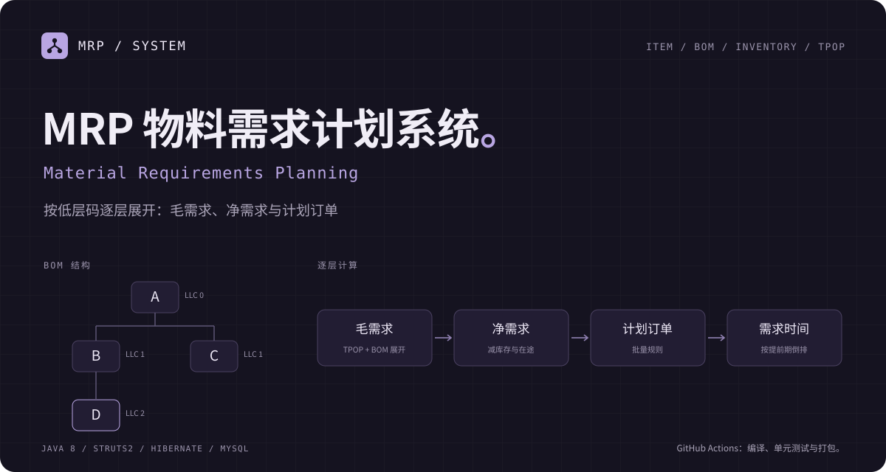

# 資材所要量計画（MRP）システム

[简体中文](README.md) · [English](README.en.md) · [Español](README.es.md) · **日本語**

多階層の部品表（BOM）を使った資材所要量計画を扱う Java 8・Struts2・Hibernate アプリケーションです。品目、BOM、在庫を登録し、最上位品目の計画発注量を入力すると、総所要量、予測在庫、計画オーダーを 13 個の期間枠で計算します。画面は JSP と Bootstrap、データベースは MySQL を使用します。計算部分はデータベースなしでテストできます。

[手計算例とデプロイ検証記録](docs/optimization-validation.md) · [Windows と Linux の CI](.github/workflows/ci.yml)

## セットアップと実行

JDK 8、Maven 3.9、Tomcat 9、MySQL が必要です。`mrp_demo` などの専用サンプルスキーマを作成して選択し、[mrp.sql](mrp.sql) または同一内容の [V1](db/migration/V1__legacy_schema.sql) の一方を取り込んでから、[V3](db/migration/V3__atomic_batches_and_past_due.sql) を一度実行します。初期化 SQL には `DROP TABLE` とサンプルデータが含まれ、スキーマの作成・選択は行いません。既存の運用データベースには実行しないでください。V3 は再計算のロック行と期間外所要量のテーブルを追加します。[V2](db/migration/V2__period_line_tables.sql) は未使用で、マイグレーションの自動適用はありません。

リポジトリのルートで PowerShell を開き、接続情報を置き換えてビルドします。

```powershell
$env:MRP_DB_URL = 'jdbc:mysql://localhost:3306/mrp_demo?useUnicode=true&characterEncoding=UTF-8'
$env:MRP_DB_USERNAME = 'mrp_user'
$env:MRP_DB_PASSWORD = '<database-password>'
powershell -NoProfile -File scripts\verify.ps1
```

このスクリプトは `mvn -B clean verify` を実行し、アプリケーションのクラス、設定、実行時依存関係が WAR に含まれていることを確認します。`target/mrp-1.0.0-SNAPSHOT.war` を `mrp.war` として Tomcat に配置します。Tomcat プロセスに三つの環境変数を引き継ぐか、[設定例](src/hibernate.properties.example) にある対応する JVM プロパティを指定します。必須設定がなければエラーになります。

`/mrp/index.jsp` を開き、品目、BOM、在庫、最上位品目の入力を画面で確認・登録します。MRP 画面では `/mrp/MRP_domrp.action` から一括再計算できます。この手順では専用サンプルスキーマを使用してください。

## 計画の流れ

| 段階 | 処理 |
| --- | --- |
| 入力 | [品目、BOM の親子関係、在庫](src/entity/) を管理します。[TPOP](src/action/TPOPAction.java) は `POR0`～`POR12` に最上位品目の計画発注量を受け取ります。受注から基準生産計画を自動生成する機能はありません。 |
| BOM 展開 | [グラフを検証](src/service/BomGraph.java) し、トポロジカル順に [所要量を集計](src/service/MrpCalculationService.java) します。複数の親を持つ共通部品の需要も合算します。 |
| 期間別計算 | 在庫、引当量、安全在庫、ロット規則から [正味所要量と計画入荷量を計算](src/util/MrpPeriodCalculator.java) し、リードタイムと安全時間の合計だけ発注時期を前倒しします。 |
| 保存 | 単一の入力スナップショットから [再計算](src/service/MrpRecalculationService.java) し、結果をバッチ単位で一括置換します。 |

- 期間枠は 0～12 の 13 個に固定されています。第 0 期の予測手持在庫、予測有効在庫、正味所要量は `-1` をプレースホルダーとします。第 0 期の総所要量と予定入荷量を第 1 期に合算し、通常の計算は第 1～12 期で行います。
- FOQ は固定ロットの整数倍に切り上げます。正味所要量 25、ロット 10 なら入荷量は 30 です。LFL は正味所要量と同量です。不正な数量・規則、FOQ のロット 0、負のリードタイム、算術オーバーフローはエラーになります。
- 第 0 期より前に発注が必要な数量は、負の期間とともに `pastDueReleases` に保持します。子品目では第 0 枠の総所要量に加え、元の期間も `pastDueGrossRequirements` に残します。いずれも対応が必要な期限超過分です。
- BOM は存在する品目と正の使用量を必要とし、循環や重複する辺を許しません。ローレベルコード（LLC）は根からの最長経路の深さと一致する必要があります。必須の最上位入力や部品在庫の欠落、レコードの重複はエラーです。
- InnoDB と `REPEATABLE_READ` を使い、DB の行ロックで再計算を直列化します。失敗時はバッチ全体をロールバックし、スナップショット取得後の入力変更は次回以降の再計算で読み込みます。

## テストとライセンス

通常のビルドは [期間計算テスト](test/util/MrpPeriodCalculatorTest.java) と [BOM 展開テスト](test/service/MrpCalculationServiceTest.java) を実行します。Python 3 があれば `python scripts\check_verify_failures.py` で、コンパイル・アサーション・パッケージングの失敗と Maven がない場合を別コピーで確認できます。

[結合テスト](test/service/MrpWorkflowIT.java) には専用 MySQL サーバーを使います。接続ユーザーにはランダムな `mrp_test_*` スキーマの作成・削除権限が必要です。運用サーバーは指定しないでください。実際の MySQL でロールバック、並行再計算、マッピングを検証し、別 JVM の Tomcat 9 に WAR をデプロイします。

```powershell
$env:MRP_TEST_MYSQL_URL = 'jdbc:mysql://127.0.0.1:33317/'
$env:MRP_TEST_MYSQL_USER = 'test_admin'
$env:MRP_TEST_MYSQL_PASSWORD = '<test-server-password>'
powershell -NoProfile -File scripts\verify.ps1 -Integration
```

リポジトリ全体に適用されるライセンスは明記されていません。
