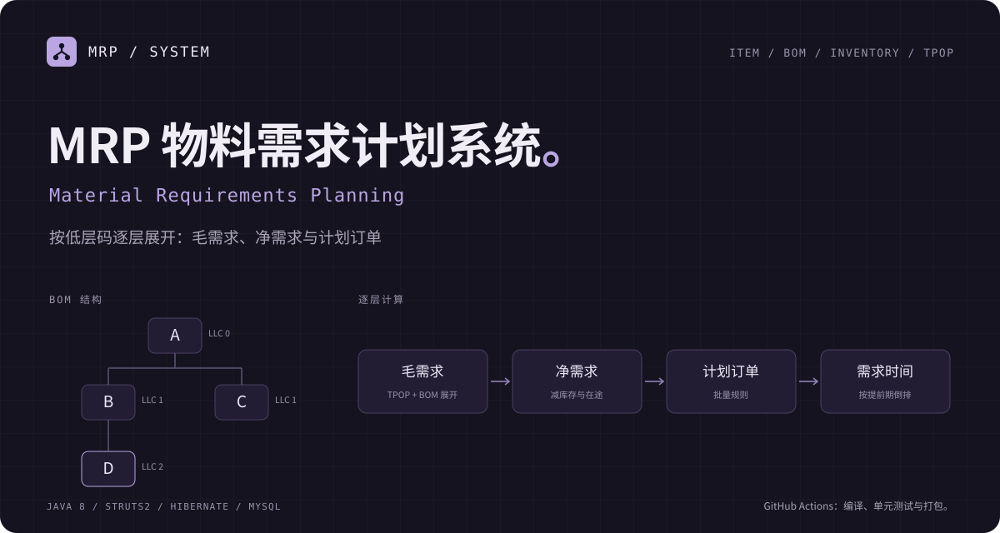

# MRP 物料需求计划系统

基于 Java 8、Struts2 和 Hibernate 的物料需求计划系统。维护物料、BOM 与库存，输入顶层物料的分期计划下达量，按低层码（LLC）展开相关需求，使用 0～12 共 13 个期段槽保存需求、预计库存与计划订单。

计算逻辑与数据库访问分开，适合阅读多层 BOM 的需求传递，并用不依赖数据库的计算测试核对规则。页面使用 JSP 与 Bootstrap，数据库使用 MySQL。

## 模块与计算过程

| 模块 | 当前作用 | 阅读入口 |
| --- | --- | --- |
| 物料、BOM、库存 | 维护物料属性、父子关系、单位用量及库存输入 | [实体与映射](src/entity/) |
| TPOP | 输入顶层物料各期的 `POR0`～`POR12` 计划下达量 | [TPOPAction.java](src/action/TPOPAction.java) |
| 多层展开 | 按 LLC 处理物料，聚合顶层输入和父项下达量 | [MrpCalculationService.java](src/service/MrpCalculationService.java) |
| 期段计算 | 使用库存、已分配量、安全库存、提前期与批量规则计算各期结果 | [MrpPeriodCalculator.java](src/util/MrpPeriodCalculator.java) |
| 应用入口 | 读取四类输入、调用计算服务并保存结果 | [MRPUtils.java](src/util/MRPUtils.java) · [MRPAction.java](src/action/MRPAction.java) |

```text
物料 + BOM + 库存 + 顶层计划下达量
  → 按低层码排序 → 汇总物料毛需求
  → 净需求与计划接收量 → 按提前期移位得到计划下达量
  → 传递到子项 → 保存各期结果
```

TPOP 当前直接接收计划下达量，不是从独立订单需求自动生成主生产计划的模块。

## 数据库与运行前提

完整应用需要 JDK 8、Tomcat 与 MySQL。在独立的示例数据库中初始化表，不要对已有业务库直接执行初始化脚本：

1. 先自行创建并选中示例库，例如 `mrp_demo`。
2. 导入 [mrp.sql](mrp.sql)。它包含 `DROP TABLE` / `CREATE TABLE`，不会自动创建或选中数据库。
3. 为运行 Tomcat 的进程设置数据库配置；缺少必要配置会明确报错。

```powershell
$env:MRP_DB_URL = "jdbc:mysql://localhost:3306/mrp_demo?useUnicode=true&characterEncoding=UTF-8"
$env:MRP_DB_USERNAME = "mrp_user"
$env:MRP_DB_PASSWORD = "填入本地示例库密码"
```

可选环境变量及对应 JVM 参数见 [hibernate.properties.example](src/hibernate.properties.example)，包括驱动、方言、建表模式与 SQL 日志设置。这里的环境变量需要由实际启动 Tomcat 的进程继承。

[V1 基线](db/migration/V1__legacy_schema.sql) 与 `mrp.sql` 相同，二选一即可。[V2](db/migration/V2__period_line_tables.sql) 是规范化期段表的预备迁移脚本；当前实体映射仍使用固定期段列，仓库没有自动执行 Flyway 迁移的配置。

## 构建与验证

在仓库根目录执行：

```powershell
powershell -NoProfile -File scripts\verify.ps1
```

[验证脚本](scripts/verify.ps1) 使用 `web\WEB-INF\lib` 中的 jar 编译源码，再运行两个计算测试入口：

- [MrpPeriodCalculatorTest](test/util/MrpPeriodCalculatorTest.java)：期段计算规则。
- [MrpCalculationServiceTest](test/service/MrpCalculationServiceTest.java)：物料之间的需求展开。

检测到 Maven 时，脚本还执行 `mvn -B -DskipTests package`，预期文件名为 `target/mrp-1.0.0-SNAPSHOT.war`。GitHub Actions 使用[同一脚本](.github/workflows/ci.yml)。

当前验证存在两个需要先解决的限制：

- 脚本尚未逐步检查外部命令的退出码，缺少 Maven 时会跳过打包。因此单看最后的退出状态不足以确认每一步成功。
- [pom.xml](pom.xml) 的 WAR 排除规则包含 `WEB-INF/classes/**` 与 `WEB-INF/lib/**`，会影响应用类和运行依赖。需要修正并检查实际 WAR 内容后，再进行 Tomcat 部署；当前没有完整部署验证记录。

## 计算边界

- 当前固定使用 13 个期段槽。第 0 期的预计库存、预计可用库存和净需求用 `-1` 占位；第 0 期的毛需求与预计入库量并入第 1 期计算，常规计算覆盖第 1～12 期。它不是任意长度的滚动计划。
- 提前期使下达时间落到第 0 期以前时，当前结果不会保留该笔期外下达量。
- FOQ 当前只给出一个固定批量，净需求超过该批量时的规则仍需明确。
- 重算结果的删除与保存尚需统一事务，异常时保留旧结果的行为需要验证。

后续重点是补齐批量和期外需求的业务规则、保证重算的原子性，并建立能够部署的 WAR 与数据库示例。
